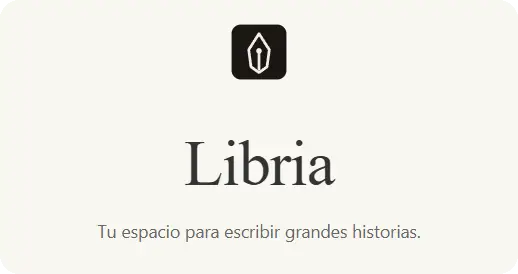

[](https://github.com/Gargadon/libria/actions/workflows/release.yml)

# Libria 2.1.1 — Rice Edition



**Libria** es un entorno de escritura profesional diseñado para autores que buscan el control total sobre su obra, desde el primer borrador hasta la maquetación final. Reúne en una única aplicación de escritorio las herramientas de edición, diseño tipográfico, revisión editorial y exportación que normalmente requieren múltiples plataformas.

---

## Características Principales

### Edición por Bloques y Organización

Libria abandona el concepto de "página en blanco" tradicional por un sistema de **edición basada en bloques** (contenteditable), permitiendo una estructura semántica clara:

- **Secciones especializadas:** Preliminares (`halftitle`, `title`, `subtitle`, `author`, `publisher`, `dedication`, `chapter-num`), cuerpo de la obra y posliminares.
- **Estados de capítulo:** Control visual del progreso (Borrador, Esquema, Listo) con indicadores de color.
- **Métricas en tiempo real:** Recuento de palabras y tiempo de lectura estimado por capítulo y total.
- **Bloques enriquecidos:** Párrafos con negrita, cursiva, subrayado y enlaces; títulos, citas, epígrafes con atribución, listas, tablas, código, saltos de escena, saltos de página e imágenes.
- **Plantillas de capítulos:** Portadilla, créditos, dedicatoria, agradecimientos e índice, con opción de iniciar un capítulo en página impar.
- **Metadatos y portada:** Título, subtítulo, varios autores y editores, editorial, año, ISBN, idioma del documento e imagen de portada.
- **Imágenes:** Inserción desde el portapapeles (Ctrl+V), desde el panel de attachments o cargando archivos. Rotación (90°, 180°, 270°), volteo horizontal y vertical, con ajuste automático de orientación EXIF. Las transformaciones se reflejan en todas las previsualizaciones (Kindle, iPhone y Papel).
- **Reordenación de capítulos:** Botones de subir/bajar en el panel lateral para reposicionar capítulos dentro de su sección (preliminares, cuerpo, posliminares).
- **Búsqueda y reemplazo global:** Vista de contexto con coincidencias resaltadas.

### Maquetación Tipográfica de Alto Nivel

Un panel de control con parámetros ajustables para ver cómo quedará tu libro mientras lo escribes:

- **Temas de Libro Personalizados:** Creación y diseño de temas propios (guardando la configuración tipográfica actual del panel de maquetación). Los temas personalizados se guardan localmente y pueden **exportarse** (como archivos `.libria-theme`) e **importarse** fácilmente desde la interfaz.
- **Temas Predefinidos:** Opciones integradas como *Clásico*, *Moderno* y *Minimalista* (este último con ajustes específicos como remoción de márgenes superiores).
- **Tipografía:** Spectral, Lora, EB Garamond, Crimson Pro, Inter, Montserrat — y cualquier fuente instalada en tu sistema (con campos personalizados para fuente del libro y de títulos).
- **Control absoluto:** Márgenes (interior/exterior/superior/inferior), interlineado, espaciado de párrafos, sangrías, justificación y alineación.
- **Detalles profesionales:** Letras capitulares (drop caps) con altura configurable, versalitas en la primera línea del primer párrafo, separadores de escena configurables, guionización automática en 5 idiomas, **comillas inteligentes**, **guiones em/en**, **puntos suspensivos tipográficos** y **signos de apertura inteligentes**.
- **Encabezados y pies:** Texto personalizado, numeración de página con posición configurable y opción de ocultar ambos en la primera página de cada capítulo.
- **Paginación dinámica:** Previsualiza en formatos estándar (5×8, 6×9, A5, A4, A6, Carta) o simulando dispositivos Kindle o iPhone.

### Revisión Ortográfica Integrada

- **Corrector propio sin conexión:** Motor `nspell` con diccionarios incluidos de español, inglés, francés, italiano y portugués. Utiliza el idioma del documento, independiente del idioma de la interfaz.
- **Corrección durante la escritura:** Subrayado de errores y sugerencias mediante clic derecho, con opciones para ignorar palabras o añadirlas al diccionario personal. El subrayado requiere compatibilidad del WebView con CSS Highlights.
- **Revisión del capítulo:** Panel accesible con `F7` para recorrer errores, ver su contexto y aplicar sugerencias conservando el formato enriquecido.
- **Diccionario personal:** Panel lateral con búsqueda, paginación, alta y eliminación de palabras. Se guarda en el almacenamiento nativo de escritorio o en LocalStorage en la versión web.

### Notas al Pie

Sistema completo de notas al pie para libros técnicos y de no ficción:

- **Inserción inline:** Referencias numéricas en el texto con contenido expandible.
- **Exportación EPUB:** Panel de notas al pie generado automáticamente en EPUB.
- **Exportación ODT:** Soporte de notas al pie nativas en formato ODT para procesadores de texto.
- **Ordenación:** Notas ordenadas por posición dentro del capítulo.

### Flujo Editorial y Revisión

Diseñado para el trabajo colaborativo entre autores y editores:

- **Notas marginales:** Comenta fragmentos específicos del texto con hilos de discusión.
- **Roles definidos:** Autor, Editor, Corrector y Editorial.
- **Hilos de conversación:** Respuestas en cada nota para discutir cambios estilísticos o estructurales.
- **Control de estado:** Marca notas como resueltas o no aplicables.

### Fichas Creativas (Worldbuilding)

- **Sin plantillas rígidas:** Fichas de personajes y lugares totalmente libres de campos obligatorios para mantener el control completo de la obra en manos del escritor.
- **Edición integrada:** Permite registrar y redactar descripciones, trasfondos o notas para cada personaje o lugar directamente en el panel lateral.
- **Persistencia:** Almacenamiento directo en el formato abierto `.libria`.

### Experiencia de Escritura

- **Modo Zen:** Ocultación total de la interfaz (topbar, sidebar y previsualización) para escribir sin distracciones. Acceso vía `F11` o botón en la barra.
- **Temporizador Pomodoro:** Control de ciclos de enfoque y descansos (cortos y largos) con alertas sonoras integradas en la barra superior.
- **Gráfica de rendimiento (Pacing):** Visualización del conteo de palabras por capítulo en formato SVG dinámico, con cálculo de meta de palabras diaria en base a fechas límite.
- **Tema claro/oscuro:** Alterna entre ambos modos con persistencia en preferencias personales. El tema oscuro no afecta la previsualización de dispositivos físicos.
- **Consulta de actualizaciones:** Desde *Acerca de* se comprueba si hay una versión nueva. El aviso siempre ofrece **Descargar**: abre en el navegador el instalador para el sistema y la arquitectura actuales (EXE en Windows, DMG en macOS o AppImage en Linux), o la página de versiones si no hay un instalador compatible. La instalación es manual.
- **Proyectos recientes:** Acceso a los últimos cinco documentos locales desde la bienvenida y listado independiente de copias de Drive disponibles en el equipo.
- **Protección al cerrar:** Aviso de cambios sin guardar y opciones para guardar, descartar o cancelar el cierre.
- **Autoguardado:** Guardado silencioso automático cada 2 minutos si el archivo ya tiene ruta.
- **Recuperación y versiones:** Copia local independiente cada 5 segundos cuando hay cambios, también para libros sin guardar. Historial persistente con puntos cada 2 minutos, hasta 10 por sesión y 50 en total (aproximadamente 200 MB). Desde el botón de historial o la bienvenida se puede restaurar como copia o añadir un capítulo recuperado con sus imágenes y comentarios. Las copias viven en los datos locales de la aplicación/navegador y no sustituyen un respaldo externo.
- **Objetivos de escritura:** Metas diarias de palabras con barra de progreso y seguimiento visual.
- **Previsualización ocultable:** Alterna la visibilidad del panel de previsualización con `Ctrl+Shift+P` para maximizar el espacio de escritura.

### Atajos de Formato

Disponibles con el foco en el editor. En macOS se utiliza `Cmd` en lugar de `Ctrl`. Los atajos de formato de texto funcionan dentro de un párrafo y en selecciones entre varios párrafos, con Deshacer/Rehacer.

| Acción | Atajo |
| :--- | :--- |
| Negrita | `Ctrl+B` |
| Cursiva | `Ctrl+I` |
| Subrayado | `Ctrl+U` |
| Limpiar formato | `Ctrl+\` |
| Insertar lista numerada | `Ctrl+Shift+7` |
| Insertar lista con viñetas | `Ctrl+Shift+8` |
| Alternar cita en el bloque actual | `Ctrl+Shift+9` |
| Insertar salto de página | `Ctrl+Enter` |
| Insertar salto de escena | `Ctrl+Shift+Enter` |

### Importación y Exportación

- **Importar:** Desde DOCX (negritas, cursivas, subrayado, enlaces, encabezados, listas, tablas, imágenes compatibles y notas al pie) y TXT (texto plano). Se muestran los avisos de conversión; las imágenes dentro de tablas/listas se colocan después del bloque. La importación conserva estructura semántica, no la paginación exacta de Word.
- **Exportación EPUB 3.0:** Estándar de la industria para distribución digital, con portada, TOC, tipografía embebida y soporte completo de listas, tablas y notas al pie.
- **Exportación DOCX:** Todos los tipos de bloque, formato enriquecido (negrita, cursiva, imágenes), tweaks tipográficos aplicados, portada y TOC opcionales.
- **Exportación ODT:** Documento OpenDocument con formato enriquecido, imágenes, listas, tablas y notas al pie nativas.
- **Exportación por capítulos:** DOCX y ODT permiten exportar el libro completo o seleccionar capítulos. EPUB y PDF se ofrecen para el libro completo.
- **Exportación PDF profesional (escritorio):** Composición con Vivliostyle, CSS Paged Media, páginas recto/verso, cajas de margen, numeración real del índice y estilos tipográficos aplicados.
- **PDF/X opcional:** Conversión mediante Ghostscript para flujos de imprenta. En Windows se incluye en el paquete; en macOS/Linux se necesita una instalación del sistema. Si la conversión falla, se informa del error.
- **Formato abierto `.libria`:** Archivo JSON autocontenido con metadatos, preferencias, capítulos, notas al pie, comentarios, imágenes, objetivos de escritura y fichas de personajes y lugares. Compatible con los documentos existentes de la versión Electron; consulta [la especificación del formato](FORMATO_LIBRIA.md).

### Internacionalización

Interfaz disponible en **español, inglés, francés, italiano, alemán y portugués** — conmutación en vivo desde el panel lateral.

---

## Especificaciones Técnicas

Libria está construida con las tecnologías más modernas para garantizar fluidez y seguridad:

| Componente | Tecnología |
| :--- | :--- |
| **Framework** | [Angular 22](https://angular.dev/) (standalone components) |
| **Gestión de Estado** | [NgRx Signals Store](https://ngrx.io/guide/signals) |
| **Entorno de Escritorio** | [Tauri 2](https://v2.tauri.app/) + Rust |
| **Motor de composición PDF** | [Vivliostyle](https://vivliostyle.org/) 11 |
| **Persistencia** | Formato abierto `.libria` (JSON autocontenido) |
| **Testing** | [Vitest](https://vitest.dev/) |
| **Estilos** | SCSS (Sass) por componente |
| **Lenguajes** | TypeScript 6.0 (Modo Estricto) y Rust |
| **Herramientas de desarrollo** | [Bun](https://bun.sh/) + Rust estable |
| **Corrector ortográfico** | `nspell` y diccionarios Hunspell incluidos |
| **Dependencias clave** | `@vivliostyle/cli` (PDF), `docx` (DOCX), `jszip` (EPUB), `hyphen` (guionado), `mammoth` (importación DOCX), `nspell` (ortografía) |

La separación del editor, los paneles y los exportadores está descrita en [la guía de arquitectura](docs/architecture.md).

### Arquitectura de Datos

El estado de la aplicación se gestiona mediante un **Signals Store** altamente optimizado que incluye:

- **Historial de Deshacer/Rehacer:** Hasta 20 instantáneas de capítulos y comentarios en memoria, independiente del historial persistente de recuperación.
- **Búsqueda Global:** Motor de búsqueda indexado con contexto de coincidencias.
- **Preferencias de usuario:** Persistencia de configuración (idioma, avatar, nombre, ancho de previsualización) en LocalStorage.
- **Temas personalizados:** Carga e inicialización automática de temas del usuario a nivel de estado en el BookStore.

---

## Para Desarrolladores

### Requisitos Previos

- **Node.js**: 22.12 o superior
- **Bun**: 1.3.14 o superior
- **Rust estable** y [prerrequisitos nativos de Tauri](https://v2.tauri.app/start/prerequisites/)

La aplicación de escritorio está disponible para Windows, Linux y macOS. El empaquetado incluye Node y Chrome Headless Shell para exportar PDF sin conexión; el motor PDF se inicia solo al exportar. Durante el desarrollo utiliza Node y Edge/Chrome/Chromium del sistema (`LIBRIA_PDF_BROWSER` permite elegir el ejecutable). Consulta los requisitos nativos, los comandos y las diferencias respecto a Electron en [la guía de Tauri](docs/tauri.md).

### Instalación y Ejecución

```bash
# 1. Clonar el repositorio
git clone https://github.com/gargadon/libria.git

# 2. Entrar al proyecto e instalar dependencias
cd libria
bun install --frozen-lockfile

# 3. Iniciar servidor de desarrollo
bun run start          # http://localhost:4300

# 4. Iniciar con Tauri
bun run tauri:dev      # Angular + ventana Tauri

# 5. Construir para producción
bun run build

# 6. Empaquetar para distribución
bun run tauri:build
```

### Google Drive

- **Cuenta y documentos:** Conexión mediante el navegador del sistema, apertura y guardado de archivos `.libria`, selector de Google Picker y elección de carpeta de destino. Los tokens se conservan en el almacén de credenciales del sistema.
- **Trabajo sin conexión:** Guardado local inmediato y subida en segundo plano, con indicación de cambios pendientes. Las copias de «Drive en este equipo» pueden abrirse sin internet ni sesión activa.
- **Sincronización:** Automática cada 30 segundos y al recuperar la conexión, o manual. Solo se sincroniza el documento abierto. Detecta cambios remotos y conflictos; permite reemplazar la versión remota, crear una copia en Drive o guardar un respaldo local antes de abrir la remota.
- **Gestión de archivos:** Lista paginada, búsqueda entre las páginas cargadas y envío de documentos a la papelera con confirmación; conserva las copias locales.

El vínculo con Drive se guarda fuera del documento `.libria`. Incluye credenciales de aplicación ofuscadas; consulta la [configuración OAuth y los detalles de sincronización](docs/google-drive.md).

### Plugins (propuesta de API)

La [especificación de plugins](docs/plugins.md) define una API pública para añadir almacenamiento, comandos y otras integraciones sin extender el formato `.libria`. Incluye un [contrato TypeScript](plugin-api/README.md) y un [ejemplo](examples/plugins/memory-storage). El cargador y el gestor todavía no están implementados.

### Scripts Disponibles

| Script | Descripción |
| :--- | :--- |
| `bun run start` | Servidor de desarrollo Angular (puerto 4300) |
| `bun run dev` | Alias de `start` |
| `bun run build` | Build de producción |
| `bun run test` | Ejecutar tests con Vitest |
| `bun run tauri:dev` | Servidor Angular + ventana Tauri |
| `bun run tauri:build` | Build + instaladores Tauri |
| `bun run tauri:prepare` | Preparar el runtime PDF y los recursos nativos |
| `bun run version:sync` | Sincronizar la versión de `package.json` con Cargo y el runtime PDF |
| `bun run test:desktop` | Pruebas de scripts de escritorio y empaquetado |
| `bun run test:drive` | Pruebas del backend de Google Drive |
| `bun run test:native` | Pruebas del backend Rust |
| `bun run benchmark:desktop` | Medir procesos y consumo de la aplicación de escritorio |

La versión se modifica únicamente en el `package.json` de la raíz; los comandos de compilación y pruebas nativas sincronizan las copias necesarias. Consulta también la [guía de medición de rendimiento](docs/benchmark.md).

Al migrar desde Electron, los documentos y temas exportados siguen siendo compatibles. Las preferencias, los recientes y las recuperaciones locales no se importan automáticamente, y Drive requiere una nueva autorización. Consulta [la guía de migración a Tauri](docs/tauri.md#compatibilidad-con-la-versión-electron).

---

## Apoya el Proyecto

Libria es un proyecto independiente desarrollado en mi tiempo libre. Si te es útil, considera apoyar su continuidad:

| Método | Link |
| :--- | :--- |
| **GitHub Sponsors** | [Sponsor](https://github.com/sponsors/Gargadon) — 0% comisión, matching disponible |
| **PayPal** | [Donar](https://paypal.me/gargadon) |
| **Ko-fi** | [Invitarme un café](https://ko-fi.com/gargadon) |
| **Crypto** | BTC: `bc1qc8yqp6ph6gwlq83a6ytjvn90qaju8huzlgh4vacfq8j6nwmav7fsl7466e` |
| | ETH/USDT (ERC-20): `0x4093Bc150bD32DF2ba4910901A8F320FC3Ce8568` |
| | XRP (Ripple, tag `98270488`): `rLSn6Z3T8uCxbcd1oxwfGQN1Fdn5CyGujK` |

Cada aportación, por pequeña que sea, ayuda a mantener el proyecto vivo. ¡Gracias!

---

## Licencia

Este proyecto está bajo la **GNU Affero General Public License v3.0**. Consulta el archivo [LICENSE](LICENSE) para más detalles. Vivliostyle, integrado como motor de composición PDF, también se distribuye bajo AGPLv3.

---
